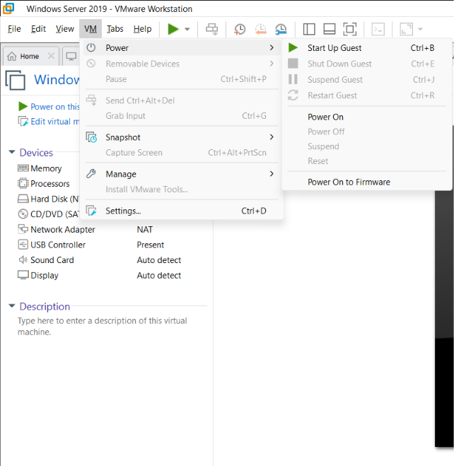
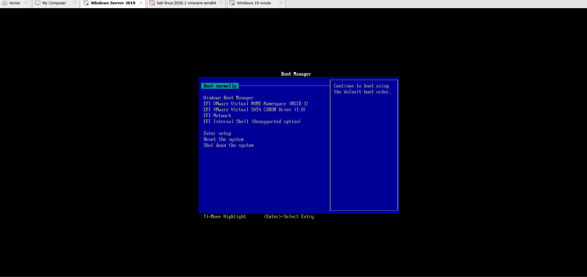
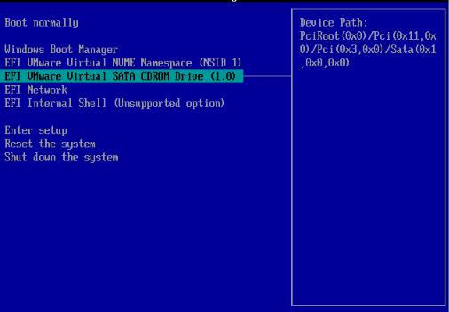
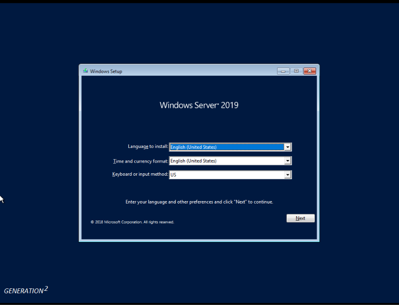
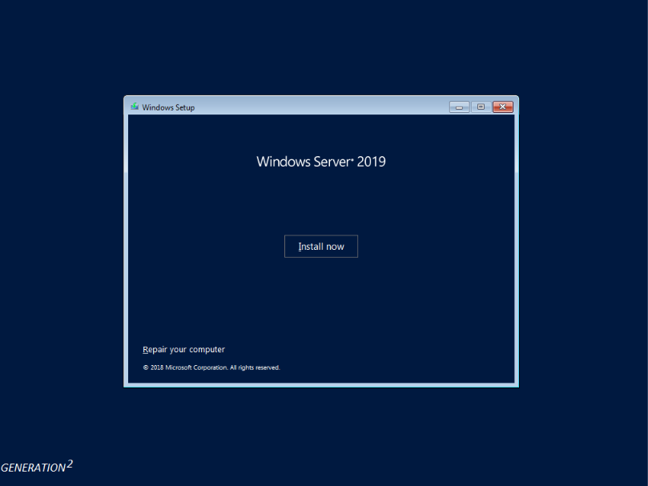
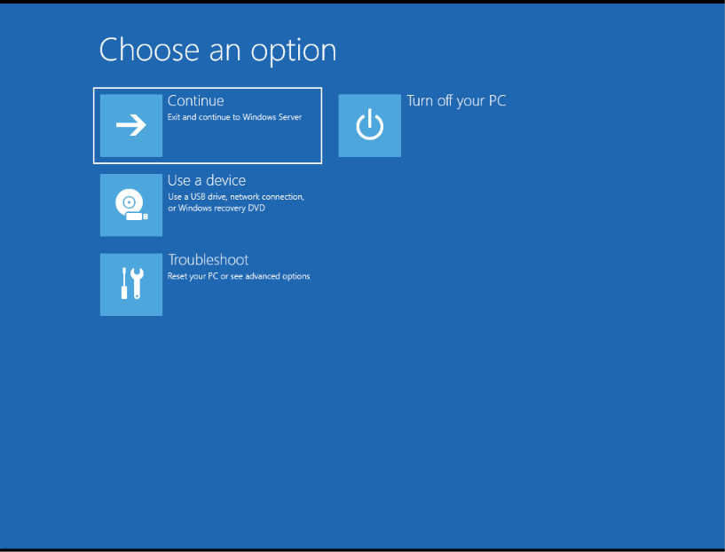
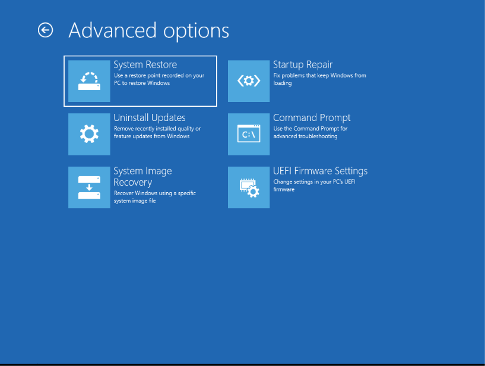
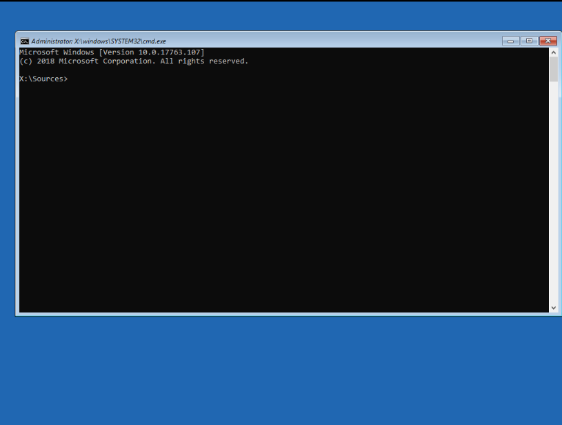

# Lab 01: Domain Administrator Password Recovery – Windows Server 2019

## 📋 Lab Overview

This lab documents an Active Directory administrative access issue in a Windows Server 2019 environment.

The issue occurred while attempting to perform privileged operations on a Windows 10 domain-joined client (`HR-PC01`). The standard domain account (`TEST\pc`) received an **Access is denied** error when attempting to manage local Administrators group membership and execute administrative operations.

The lab covers the problem investigation, VMware boot configuration, Windows Recovery Environment (WinRE), and administrative recovery considerations.

---

## 🛠️ Lab Environment

- **Domain Controller:** Windows Server 2019
- **Domain Name:** `test.local`
- **NetBIOS Domain:** `TEST`
- **Client Machine:** Windows 10 Pro (`HR-PC01`)
- **Standard Domain User:** `TEST\pc`
- **Target Account:** `TEST\Administrator`
- **Virtualization Platform:** VMware Workstation

---

## 🚀 Step-by-Step Troubleshooting

### 1. Identifying the Permission Issue

While attempting to perform administrative operations on the Windows 10 client, Windows requested Domain Administrator credentials.

The standard domain account did not have sufficient privileges to complete the requested operations.


---

### 2. Accessing VMware Firmware

Switched to the Windows Server 2019 virtual machine in VMware Workstation.

Navigated to:

**VM > Power > Power On to Firmware**

This opened the virtual machine firmware interface to select the required boot device.



---

### 3. Selecting the Windows Server ISO

The VMware Boot Manager appeared.

Selected the following boot device:

`EFI VMware Virtual SATA CDROM Drive (1.0)`

This allowed the virtual machine to boot from the attached Windows Server 2019 ISO.





---

### 4. Entering Windows Recovery Environment (WinRE)

After booting from the ISO, the Windows Server 2019 Setup screen appeared.

Selected the language and keyboard preferences, then clicked **Next**.



Instead of proceeding with installation, selected:

**Repair your computer**



---

### 5. Navigating Advanced Recovery Options

From the recovery menu, selected:

**Troubleshoot > Advanced options > Command Prompt**

This opened the Windows Recovery Environment Command Prompt.





---

### 6. Recovery Command Prompt

The Command Prompt opened in the Windows Recovery Environment.

The initial working directory was:

`X:\Sources>`

This environment provides command-line troubleshooting tools for Windows recovery tasks.



---

### 7. Administrative Recovery and Validation

After accessing the recovery environment, the next stage requires an authorized Active Directory recovery procedure.

For an authorized lab environment, administrative recovery should use an approved recovery account or verified backup procedure.

Once access has been restored, verify the current identity:

```cmd
whoami
```

Check the current user's group memberships:

```cmd
whoami /groups
```

Verify the domain Administrator account:

```cmd
net user Administrator /domain
```

---

### 8. Post-Recovery Security Checks

After completing the authorized recovery procedure:

- Verify Domain Administrator access.
- Check Active Directory Users and Computers.
- Confirm the required administrative group memberships.
- Verify that the Windows client can communicate with the Domain Controller.
- Ensure no temporary recovery modifications remain on system files.

---

## 📚 Key Takeaways

1. **User Privileges:** Standard domain users cannot perform every administrative operation on domain-joined machines.

2. **Domain vs. Local Accounts:** `HR-PC01\Administrator` refers to the local account, while `TEST\Administrator` refers to the domain account.

3. **VMware Boot Configuration:** Understanding firmware and ISO boot options is useful when troubleshooting virtual machines.

4. **Windows Recovery Environment:** WinRE provides useful tools for diagnosing and recovering Windows systems.

5. **Security Best Practices:** Administrative recovery must be followed by validation, cleanup, and proper protection of privileged credentials.

---

## 🏁 Conclusion

This lab provided practical exposure to Windows Server 2019 troubleshooting and Active Directory administrative access issues.

It also demonstrated the importance of understanding Windows Recovery Environment, VMware firmware settings, domain authentication, and administrative privileges.

**Technologies:** Windows Server 2019 | Active Directory | Windows 10 | VMware Workstation | WinRE | Command Prompt
