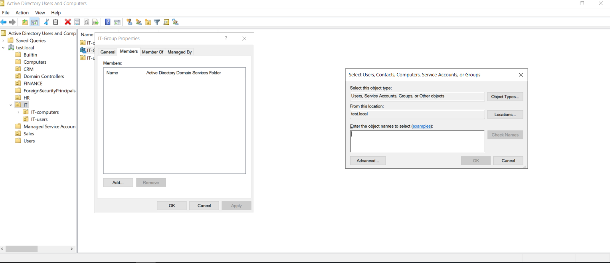
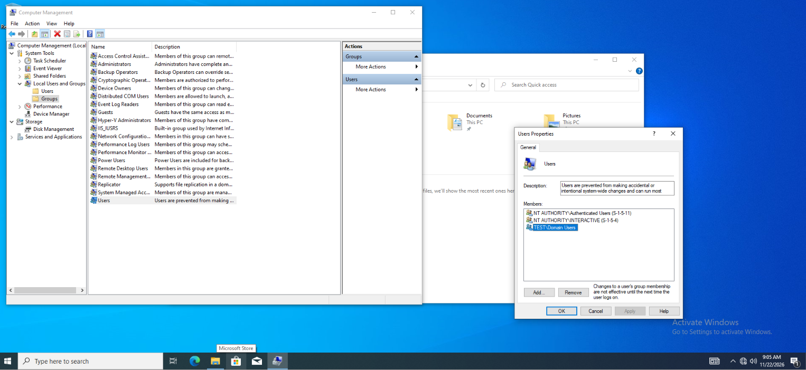
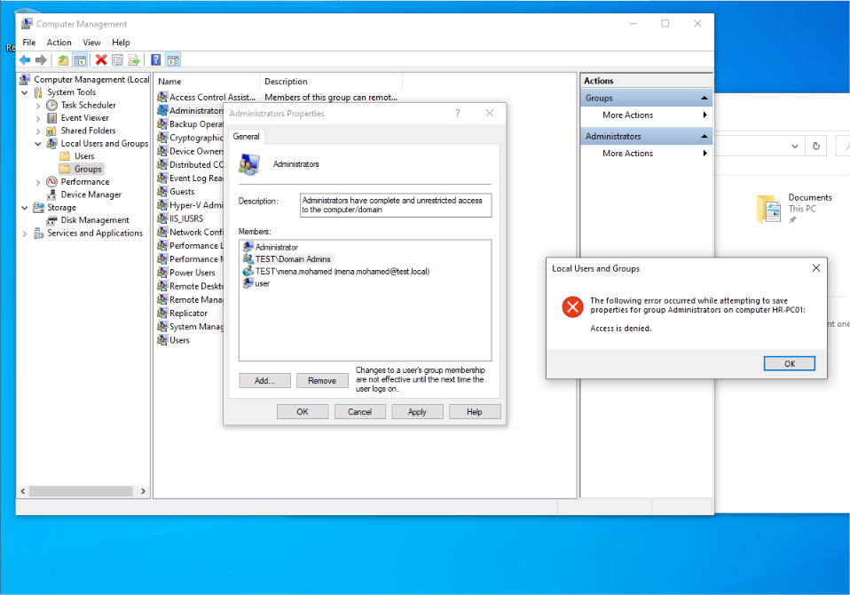
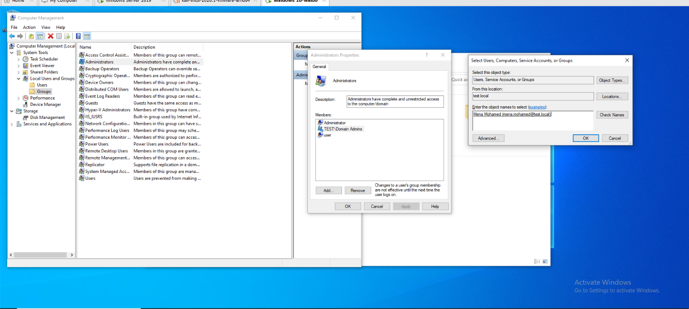
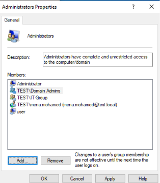
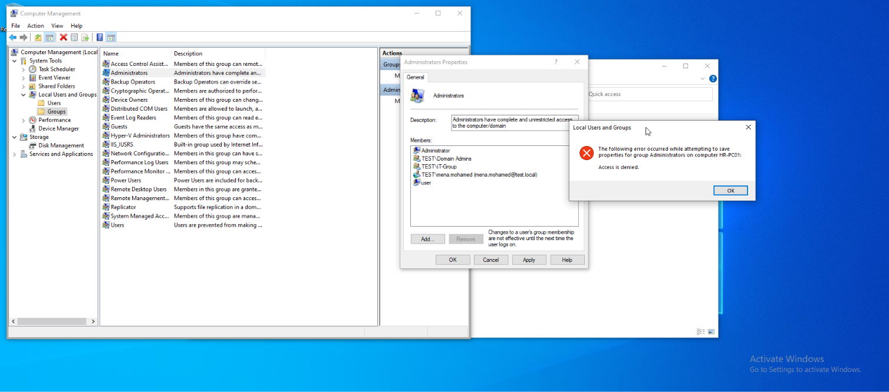

# Lab 02: Joining a Client Machine to a Windows Server Domain

## 📋 Lab Overview

This lab demonstrates the process of joining a Windows 10 client machine (`HR-PC01`) to an Active Directory Domain (`test.local`) hosted on Windows Server 2019.

During the process, a DNS lookup timeout issue (`ERROR_TIMEOUT`) prevented the client from locating the Domain Controller.

The lab covers client network preparation, domain joining, DNS troubleshooting, authentication, and final verification.

---

## 🛠️ Lab Environment

| Component | Configuration |
|---|---|
| Domain Controller | Windows Server 2019 |
| Domain Name | `test.local` |
| Domain Controller IP | `192.168.1.2` |
| Client OS | Windows 10 Pro |
| Client Computer | `HR-PC01` |
| Client IP | `192.168.1.20` |
| Preferred DNS Server | `192.168.1.2` |
| Virtualization | VMware Workstation |

---

## 🚀 Step-by-Step Execution

### 1. Client Preparation (IP & DNS Configuration)

Before joining the domain, the Windows 10 client was prepared by performing the following configurations:

- Synchronizing the system date and time.
- Renaming the computer to `HR-PC01`.
- Configuring a static IP address: `192.168.1.20`.
- Setting the Domain Controller (`192.168.1.2`) as the Preferred DNS Server.

**Important:** The client must use the Active Directory DNS server to correctly resolve domain records.



---

### 2. Attempting to Join the Domain

Navigated to:

**System Properties > Computer Name > Change**

Changed the membership from `WORKGROUP` to `Domain` and entered:

```text
test.local
```



---

### 3. Troubleshooting: Active Directory Domain Controller Error

During the domain join attempt, Windows displayed the following error:

> An Active Directory Domain Controller (AD DC) for the domain 'test.local' could not be contacted.



#### Diagnosis & Resolution

**1. Network Connectivity Check**

Executed the following command from the client Command Prompt:

```cmd
ping 192.168.1.2
```

The test confirmed successful connectivity to the Domain Controller with 0% packet loss.

**2. Root Cause Analysis**

After checking the error details, the error code was identified as:

```text
0x000005B4 ERROR_TIMEOUT
```

The investigation pointed to a DNS SRV record query failure.

**3. DNS Configuration Correction**

The client DNS configuration was corrected to point to the Domain Controller (`192.168.1.2`).

After correcting DNS, the client was able to resolve the domain name successfully.



---

### 4. Authentication & Domain Join Confirmation

After resolving the DNS issue, the domain join process was retried.

Windows displayed a credentials prompt requesting an account authorized to join computers to the domain.

The IT Admin credentials were entered to continue.



After successful authentication, Windows displayed the following confirmation:

> Welcome to the test.local domain.



---

### 5. Verification on Server & Client Login

#### 1. Active Directory Verification

Opened **Active Directory Users and Computers** on Windows Server 2019.

Verified that the client computer `HR-PC01` appeared under the default `Computers` container.


#### 2. Client Restart & Domain Login

Restarted the Windows 10 client machine.

After rebooting, successfully signed in using a domain account.


---

## 📚 Key Takeaways

1. **Static IP Configuration:** Configuring a proper IP address is an important step when preparing a client machine for domain joining.

2. **DNS Configuration:** Active Directory depends heavily on DNS to locate Domain Controllers and discover domain services.

3. **Network Connectivity vs. DNS Resolution:** A successful ping test does not guarantee that DNS queries and Active Directory service discovery are working correctly.

4. **DNS SRV Records:** Active Directory uses DNS SRV records to help clients locate Domain Controllers.

5. **Domain Authentication:** Joining a computer to a domain requires valid credentials authorized to perform the operation.

6. **Verification:** Always verify the computer account in Active Directory Users and Computers and test domain login from the client.

---

## 🏁 Conclusion

This lab provided practical experience in joining a Windows 10 client machine to a Windows Server 2019 Active Directory Domain.

The main challenge was a DNS lookup timeout issue that prevented the client from locating the Domain Controller.

By checking network connectivity, investigating the DNS error, and correcting the client's DNS configuration, the domain join process was completed successfully.

**Technologies:** Windows Server 2019 | Active Directory | Windows 10 | DNS | VMware Workstation | Domain Join
