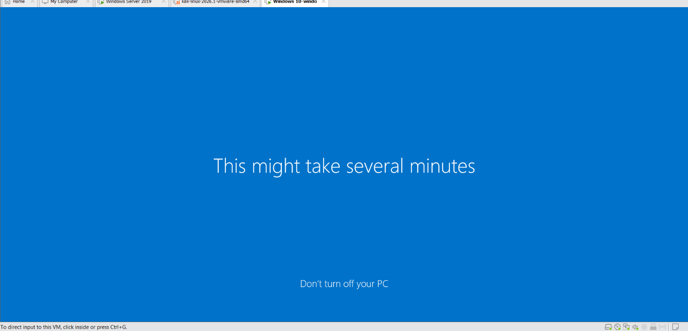
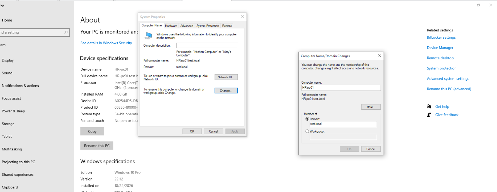
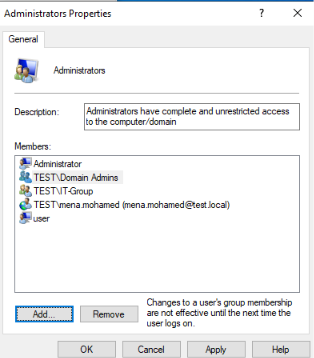
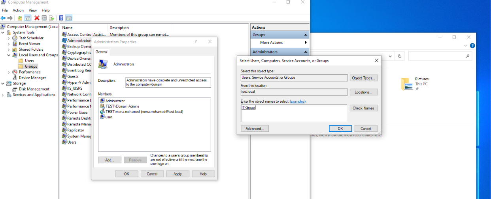
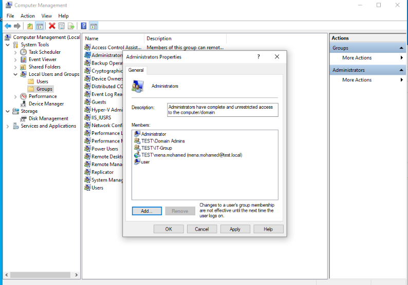

# Lab 03: Managing Local Users & Groups on a Domain-Joined Client

## 📋 Lab Overview

This lab demonstrates managing local users and groups on a Windows 10 Pro client machine joined to a Windows Server 2019 Active Directory Domain.

The lab focuses on inspecting local group memberships, identifying domain users and security groups, and managing membership in the local `Administrators` group.

During the process, an **Access is denied** error occurred when attempting to save changes without sufficient administrative privileges. The required domain user and security group were subsequently added successfully, and their membership was verified.

---

## 🛠️ Lab Environment

| Component | Configuration |
|---|---|
| Server OS | Windows Server 2019 |
| Client OS | Windows 10 Pro (22H2) |
| Virtualization | VMware Workstation |
| Domain Name | `test.local` |
| NetBIOS Domain | `TEST` |
| Client Computer | `HR-PC01` |
| Client FQDN | `HR-pc01.test.local` |
| Domain User | `mena.mohamed` |
| Security Group | `IT-Group` |

---

## 🏢 Active Directory Structure

The domain environment contains multiple Organizational Units (OUs) to organize users and computers.

The main OUs include:

- `HR`
- `IT`
  - `IT-computers`
  - `IT-users`
- `Sales`
- `FINANCE`

The environment also includes domain security groups such as `IT-Group` and domain users such as Mena Mohamed (`mena.mohamed@test.local`).

---

## 🚀 Step-by-Step Execution

### 1. Preparing the Windows 10 Client

The Windows 10 client machine was prepared and configured as part of the Active Directory lab environment.

---

### 2. Verifying Domain Membership

After preparing the client, the system properties were checked to confirm its identity and domain membership.

The following details were verified:

- Computer Name: `HR-PC01`
- Operating System: Windows 10 Pro (22H2)
- Domain: `test.local`
- Full Computer Name: `HR-pc01.test.local`

---

### 3. Inspecting Local Users and Groups

Opened **Computer Management** on the client machine and navigated to:

**Computer Management > Local Users and Groups > Groups**

Selected the local `Users` group to inspect its members.

The inspection showed that `TEST\Domain Users` was already a member of the local Users group.

---

### 4. Reviewing Active Directory Structure and IT-Group

Opened **Active Directory Users and Computers** on the Domain Controller.

Reviewed the domain structure, including the available Organizational Units:

- HR
- IT
- Sales
- FINANCE

Then opened the properties of `IT-Group` and inspected its Members tab.

---

### 5. Selecting a Domain User for Local Administrators

Returned to the Windows 10 client and opened the local `Administrators` group properties.

Used the **Select Users** dialog to locate the domain user:

`TEST\mena.mohamed`

The selected account was Mena Mohamed (`mena.mohamed@test.local`).

---

### 6. Troubleshooting: Access Is Denied

While attempting to save the changes to the local `Administrators` group, Windows displayed an error:

> Access is denied.

This indicated that the current account did not have sufficient permissions to modify the local Administrators group.

---

### 7. Inspecting Administrators Group Membership

Inspected the existing members of the local `Administrators` group on `HR-PC01`.

The displayed membership included accounts such as:

- `Administrator`
- `TEST\Domain Admins`
- `TEST\IT-Group`
- `TEST\mena.mohamed`
- `user`

---

### 8. Troubleshooting Domain Group Addition

Another attempt to modify the local Administrators group by adding the domain security group `IT-Group` resulted in the same error:

> Access is denied.

This confirmed that sufficient administrative privileges were required to save changes to the local Administrators group.

---

### 9. Selecting the Domain User Successfully

Opened the **Select Users, Computers, Service Accounts, or Groups** dialog.

Selected the domain user:

`Mena Mohamed (mena.mohamed@test.local)`

The selection was made from the `test.local` domain.

---

### 10. Selecting the IT-Group Security Group

Used the same selection dialog to locate and select the domain security group:

`IT-Group`

This group was selected from the `test.local` domain for addition to the local Administrators group.

---

### 11. Final Verification – Administrators Group Membership

After completing the administrative changes successfully, the local Administrators group properties were checked again.

The final membership list confirmed the presence of:

- `TEST\IT-Group`
- `TEST\mena.mohamed (mena.mohamed@test.local)`

This verified that both the domain user and the domain security group were successfully added to the local Administrators group.

---

## 📚 Key Takeaways

1. **Domain vs. Local Groups:** Active Directory domain users and groups can be added to local security groups on domain-joined computers.

2. **Local Users and Groups:** Computer Management provides a graphical interface for inspecting and managing local accounts and groups.

3. **Access Denied:** Modifying the local Administrators group requires sufficient administrative privileges.

4. **Active Directory Organization:** Organizational Units help organize domain users, computers, and administrative resources.

5. **Security Groups:** Adding a domain security group to a local Administrators group can provide administrative access to all eligible members of that domain group.

6. **Verification:** Always verify group membership after making administrative changes to ensure the configuration was saved successfully.

---

## 🏁 Conclusion

This lab provided practical experience in managing local users and groups on a domain-joined Windows 10 machine.

It demonstrated how to inspect local group memberships, identify Active Directory users and security groups, troubleshoot permission-related errors, and verify successful administrative group membership changes.

The lab also highlighted the importance of understanding the relationship between Active Directory security groups and local Windows security groups.

**Technologies:** Windows Server 2019 | Active Directory | Windows 10 Pro | Local Users and Groups | Security Groups | VMware Workstation
